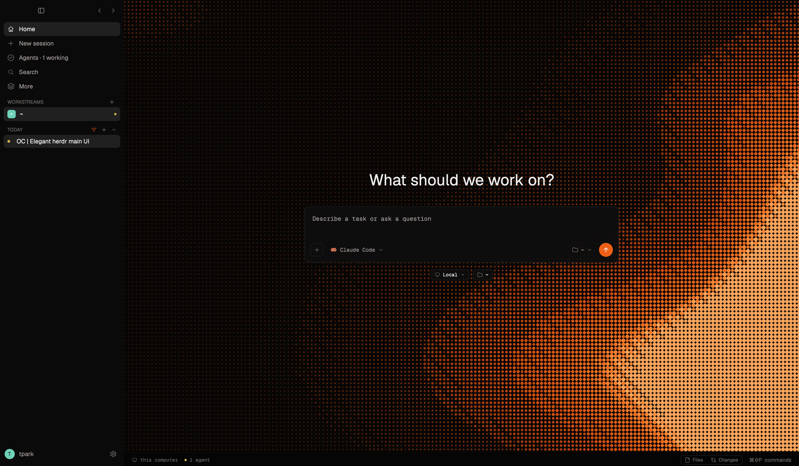

# Factory

A warm, near-black desk for agents: a sidebar of workstreams and sessions, a home screen asking “What should we work on?”, and a dusk rendered as a dot matrix that rises from the bottom-right corner.

## What you see

The window has no title bar. macOS's window buttons sit over the sidebar's top row.

The sidebar is 268px of near-black `#0a0a0a`, four blocks of the same mod:

- **Head**, 46px: the sidebar toggle on the left, space ‹ › on the right. On macOS it starts 76px in, so the window buttons keep their place.
- **Nav**, 156px: five rows of 30px — Home, New session, Agents (with a working count and an orange dot when something needs you), Search, More.
- **Lists**: the section label `WORKSTREAMS` (10.5px, uppercase, `#6f6a66`), then one row per space at 30px: an 18px colour chip with the space's initial, the name, the machine when it is remote, the branch (not `main`), a status dot, and the age in Geist Mono. Then the sessions, grouped by recency — `TODAY`, `LAST 7 DAYS`, `LAST 30 DAYS`, `OLDER`, and `SETTLED · n` — each group foldable, with a filter and a `+` on the first group. A session row is 28px: a 12px status gutter, the name (the tab's name, else the title of what runs in it, else its number), a `Z` when zoomed, the age, and a `×` on hover.
- **Foot**, 52px: a teal circle with the user's initial, the user's name, an update dot when one waits, and the settings gear.

The work area is a stack of two blocks:

- **Home**: the dusk. A 2400×1400 halftone — a 12px grid of round dots whose size and colour follow a light field, so a plume of `#ff8a38` and pale orange rises from the bottom-right over `#070605`, with a fine dot texture across the rest. Above it, “What should we work on?” at 34px regular, then a composer card (680px wide, radius 10, `#0d0d0d`, hairline `#1f1f1f`, mono placeholder): a `+`, the agent pill (the chosen agent's icon, name and a chevron), the folder chip and a round `#ee6018` send button. Under the card, two mono chips with chevrons: the machine the session will start on, and the workstream.
- **Work**: the shown tab's terminals as cards — 10px inset, 8px gap, radius 10, `#0e0e0e` on `#050505`, a 1px `#1f1f1f` border, and a 30px pane header that appears on hover (the shipped `pane` mod: icon, name, folder, status, split/zoom/close).

The right panel (Files or Changes, 368px, inset 10px) is a card of the same family and starts hidden.

The status line is 26px on `#050505`: machine, branch, agent count with a pulsing `#d8b64a` dot while anything works, `· n needs you` in `#ee6018`, then one bordered segmented switch for Files and Changes, and the palette hint in Geist Mono.

Theme `factory` (dark only): canvas `#050505`, chrome `#0a0a0a`, cards and terminals `#0e0e0e`, border `#1f1f1f`, text `#f2f2f2`, muted `#a49d9a`, dim `#6f6a66`, accent `#ee6018`; working `#d8b64a`, done `#8fd18f`, blocked `#e2695a`. Geist for labels, Geist Mono for numbers, JetBrains Mono in terminals.

## How it behaves

- **Home and work.** Clicking a session or a workstream, or starting a session, shows the work area. The Home row, or `⌘⇧H`, returns. Switching space from the keyboard while Home is shown moves to work by itself, so `ctrl-2` never leaves a stale screen.
- **Sessions.** Click: select the space, select the tab, show work. Double-click: rename (`tab.rename`). Hover: `×` closes. Right-click: Herdr's tab menu. A working agent shows a 6px `#d8b64a` dot easing between 35% and 100% opacity every 1.3s (native `.loop`, no timers); blocked, done and idle show flat dots; the active tab sits on `#202020`.
- **Group folds.** The whole header row toggles its group, and the fold is remembered per install. The filter icon limits sessions to the active workstream. `+` opens Herdr's new-session menu.
- **Workstreams.** Click selects and shows work. Drag reorders (`space.move`) with an accent line showing the landing spot. Right-click opens Herdr's space menu, so worktrees and rename are there. Colour chips come from the shared `space.colors` map, so other Herdr views agree. A space whose machine is not answering gets a red dot.
- **The sidebar folds to a rail.** `⌘B`, the head button or More > Collapse sidebar resize the column to 76px (44px off macOS): the window buttons own the top row, then Home, New, Agents, Search, More, workstream initials with a status dot, and `»` with the gear at the bottom. `⌘B` again, or `»`, brings the full width back. It never hides, so the window buttons always have their corner.
- **The composer.** Enter in the box (or the send button) starts a session: the chosen agent as `argv`, the text as `task`, and the first six words as the tab name.
- **The agent pill** opens a list: the installed agents from `knownAgents` (checked one marked), then a plain Shell, then “More to start…” for Herdr's own new-session menu. The choice is remembered in shared state (`factory.agent`).
- **The machine chip** opens where the next session starts: *Follow this workstream* (the active space's machine, the default), *This computer*, each machine from `machines()`, and *Add machine…*. Choosing another machine runs `space.new` on it with the first tab already running the agent; choosing the space's own machine just adds a tab there. The choice is remembered (`factory.machine`).
- **The folder chip** opens the system folder picker. It only sees this computer, so it is disabled with a reason when the target is another machine.
- **The status line.** The agent count opens the agents dialog (statuses, pins, sub-agents, sort). Files and Changes swap the right panel and close it when pressed again. The palette hint shows the key actually bound to `app.palette`.
- **Keys added for this layout** (`layout:factory`): `⌘⇧H` home, `⌘⇧J` back to work, `⌘B` sidebar rail.

## Built from

`layouts/factory.json` — a root row with `"titlebar": "none"`, `"theme": "factory"`, `"traffic_lights": [16, 18]`, `"terminal_padding": [16, 20]`. Children: the `sidebar` column (`size 268`, `min 44`, `max 460`) holding four `factory-sidebar` blocks with `props: { part: "head" | "nav" | "list" | "foot" }` (the head is `window_drag`); and the `work` column with `work-body` (a row, `gap 0`) holding `main-stack` (`stack`, `weight 1`, `min 0`, `active: "work"`) and the hidden `panel` column (`368`, `padding 10`), then the `status` block (26px).

`main-stack` holds the `work` block — `padding: 10`, `content: { tab: "active", pane: { gap: 8, radius: 10, background: "background", lone: true, border: 1px "border", focus: 1px "input", header: { mod: "pane", height: 30, position: "top", reveal: "hover" } } }` — and the `home` block, whose `background` is `{ image: "mods/factory-home/halftone.png", fit: "cover" }` and whose content is `factory-home`.

`panel` holds a stack (`active: "files"`) with the shipped `files` and `changes` mods.

`mods/factory-sidebar/main.js` — nav, workstreams, sessions and footer, one class. Reads `spaces()`, `agents()`, `panes()`, `machines()`, `layout()`, `window()`, `home()`, `shared`/`setShared` (space colours, rail width), `updates()`, `nextCommand()` (the `⌘B` command). Runs `space.select`, `space.new`, `space.move`, `tab.select`, `tab.new`, `tab.close`, `tab.rename`, `layout.select`, `layout.resize`, `layout.show`, `layout.hide`, `app.settings`, `app.palette`, `pane.focus`, and opens the shipped `menu`, `picker`, `new-menu` and `agents` mods.

`mods/factory-home/main.js` — the composer. `TextareaState` with auto-grow, `knownAgents()`, `pickFolder()`, `run("tab.new", { space, folder, argv, task, name })`, `run("layout.select", { stack: "main-stack", child: "work" })`. Its icons are `arrow-up.svg` and `autonomy.svg`.

`mods/factory-agents/main.js` — the agent list popup behind the pill. `knownAgents()`, `setShared("factory.agent")`, and it hands “More to start…” to the shipped `new-menu`.

`mods/factory-machines/main.js` — the machine list popup behind the chip. `machines()`, `setShared("factory.machine")`, and it hands *Add machine…* to the shipped `machine-add` mod.

`mods/factory-status/main.js` — the status line. `layout()` for the panel state, `agents()`, `keys()` for the palette hint.

`mods/factory-more/main.js` — the More popup: Files, Changes, Close the panel, Collapse sidebar, Settings, Shortcuts, What's new, Add machine.

`mods/factory-home/halftone.png` — the dusk, drawn by `halftone.py` in the same folder (`python3 halftone.py`): 2400×1400, a 12px dot grid, each dot's radius and colour from a field of five soft blobs plus a quiet centre, with a ±2 step of grain so it dithers instead of banding.

Shipped mods this layout uses: `pane`, `files`, `changes`, `menu`, `new-menu`, `picker`, `agents`, `machine-add`, and the icons in `mods/workspace-chrome/`.

## Watch out

- Background image paths in a layout resolve from the app's own folder (`~/.config/herdr-app`), not the home folder: `mods/factory-home/halftone.png` works, `.config/herdr-app/…` does not. This build also served SVG backgrounds poorly, so the dusk is a PNG.
- A running Herdr caches module-scope values and asset paths per source version. Keep per-build values on the class (this layout's `m(name)` helpers do), and restart the app before judging a changed asset.
- An SVG spinner (`svg(…).spin(900)`) drew nothing here, so the working mark is a pulsing dot. If the spinner works on your build, swap it in at `factory-sidebar`'s session row.
- The composer's folder picker runs on this computer only, so it is disabled for a space on another machine.
- The sidebar never hides, only folds to the rail: `titlebar: "none"` plus a hidden sidebar would leave the window buttons over the work card.
- The machine and agent choices persist in `shared.json`; *Follow this workstream* in the machine list clears the machine one.
- Not implemented: dragging sessions between positions (the list is grouped by date, so there is no honest drop index), worktree nesting under its repo, ahead/behind counts, and the machine login guidance. Worktrees appear as their own workstreams, agents live in a dialog rather than a permanent list.
- Needs Geist, Geist Mono and JetBrains Mono, all of which ship with Herdr.

## Done when

- `herdr-app check mods/factory-sidebar`, `…/factory-home`, `…/factory-status`, `…/factory-more` all pass.
- `herdr-app do layout.switch --name factory` shows the sidebar, the home screen and the halftone dusk; `errors` in `herdr-app status` is empty.
- A session whose agent works shows the yellow dot pulsing at the left of its row; the row's `×` appears on hover.
- `⌘B` folds the sidebar to the rail with the window buttons clear at the top, and `⌘B` again restores it.
- Clicking a session in the sidebar shows its terminals as cards; the composer's send button starts a session and lands on it.
